# Android 18 Desktop Pet · 人造人18号桌宠

> **一个会聊天、会记事、会提醒你喝水的桌面伙伴。** 透明立绘常驻桌面，接 DeepSeek 等云端 API，也能完全离线跑本地 GGUF 模型；兼容 SillyTavern 角色卡，换一张卡就是另一个角色。


[](https://github.com/Fiesty-Abyss/Android18DesktopPet/actions/workflows/ci.yml)
[](https://github.com/Fiesty-Abyss/Android18DesktopPet/releases/latest)

<table>
  <tr>
    <td width="34%" rowspan="2"><a href="docs/screenshots/01-pet-chat.png">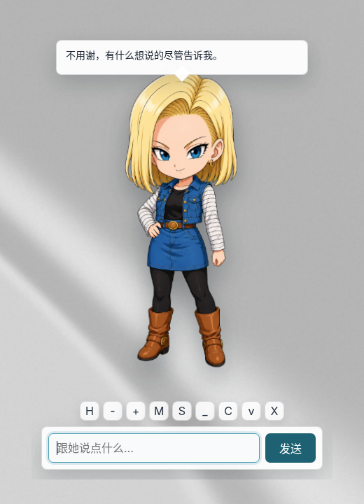</a><br><sub><b>桌宠本体</b> · 透明立绘 + 气泡对话</sub></td>
    <td width="33%"><a href="docs/screenshots/08-simulation.png">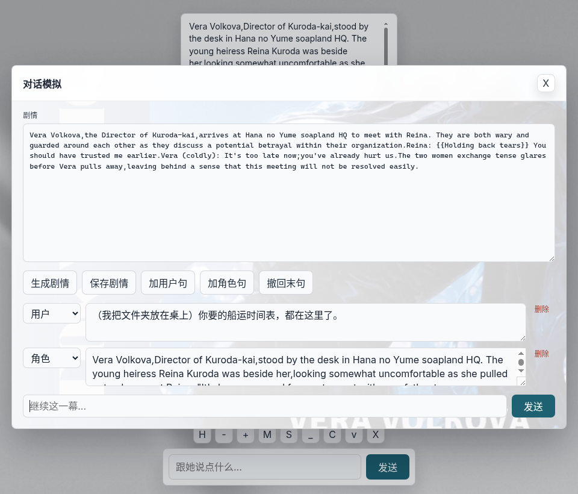</a><br><sub><b>对话模拟</b> · 逐句推进的剧情对话</sub></td>
    <td width="33%"><a href="docs/screenshots/12-png-card-import.png">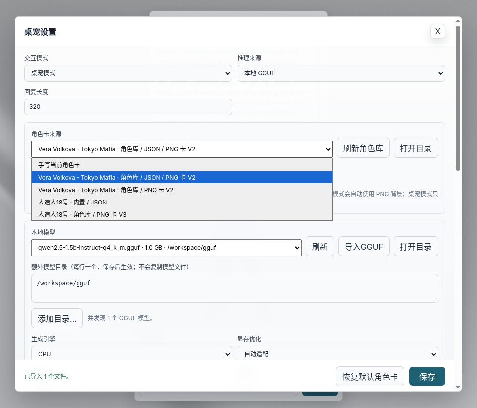</a><br><sub><b>角色卡</b> · 直接导入 SillyTavern PNG 卡</sub></td>
  </tr>
  <tr>
    <td><a href="docs/screenshots/04-settings-local.png">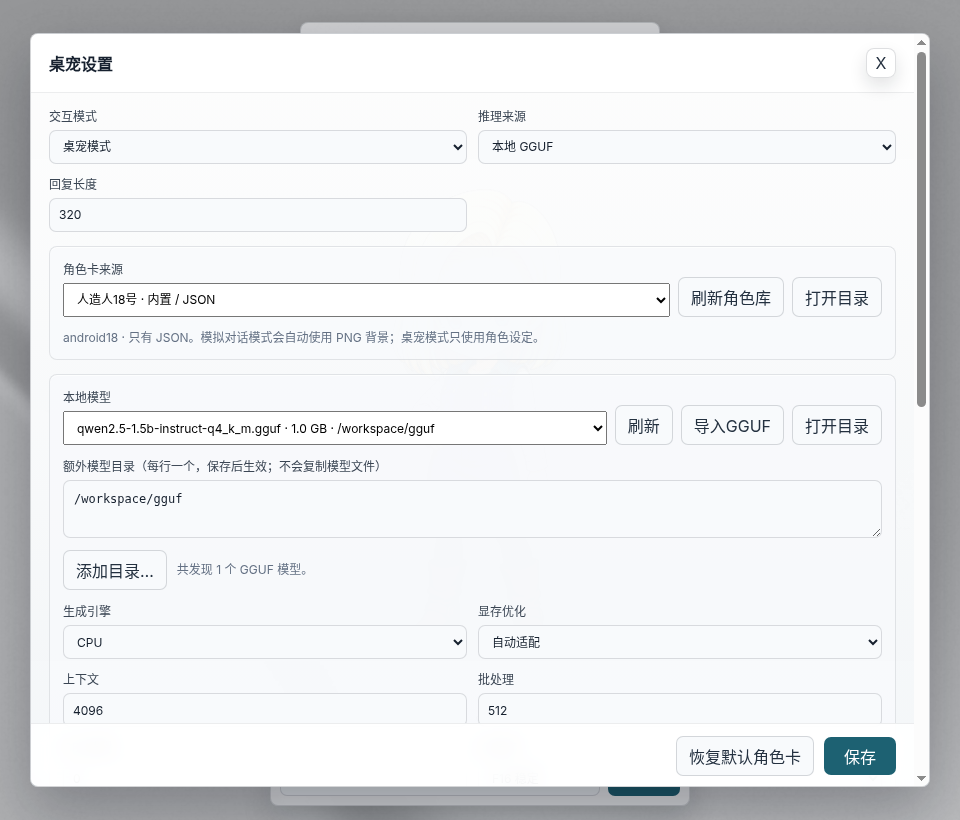</a><br><sub><b>本地模型</b> · GGUF 离线推理，CUDA / Vulkan / CPU</sub></td>
    <td><a href="docs/screenshots/11-plugins-settings.png">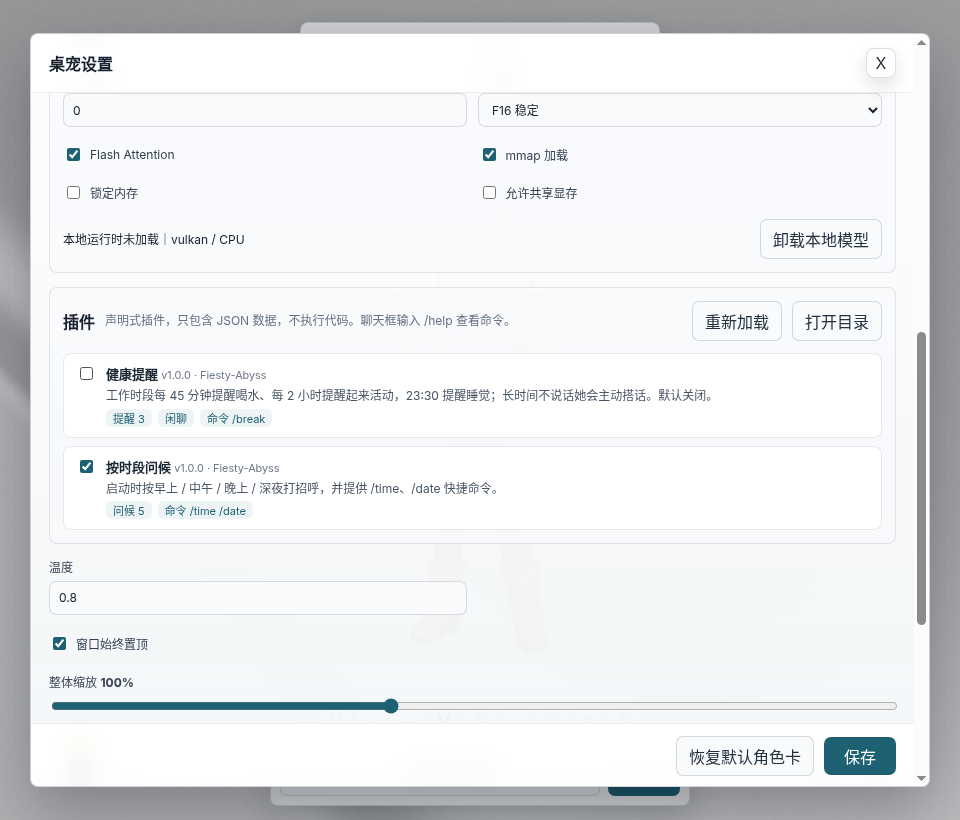</a><br><sub><b>插件</b> · 问候、提醒、快捷命令</sub></td>
  </tr>
</table>

**[⬇ 下载 Windows 安装包](https://github.com/Fiesty-Abyss/Android18DesktopPet/releases/latest)** · [快速开始](#快速开始) · [亮点](#亮点) · [适用场景](#适用场景) · [为什么是它](#为什么是它) · [功能详解](#功能详解) · [FAQ](#faq) · [路线图](#路线图) · [更新日志](CHANGELOG.md)

[本地模型说明](models/README.md) · [角色卡库说明](character-cards/README.md) · [聊天记录格式](chats/README.md) · [插件开发](plugins/README.md)

---

## 亮点

| | 亮点 | 说明 |
| --- | --- | --- |
| 🪟 | **真正的桌面宠物** | 无边框透明窗口，立绘带待机 / 思考 / 开心 / 出错动画，拖到哪待在哪，可缩放、可收进托盘 |
| ☁️ / 💻 | **云端、本地随意切** | DeepSeek 等 OpenAI 兼容接口开箱即用；也可选本地 GGUF 模型完全离线，CUDA / Vulkan / CPU 三种后端 |
| 🧩 | **兼容 SillyTavern 角色卡** | 导入 JSON 或 PNG 卡（V2 / V3），也能把当前角色导出成 PNG 卡拿去 SillyTavern 用 |
| ❤️ | **有“关系”的对话** | 好感度从厌恶到亲近五个阶段，会改变她说话的语气；夸她加分，骂她扣分 |
| 🎬 | **对话模拟模式** | 写一段剧情，逐句推进；每一句都能改、能删、能插入，适合写完整的角色剧情 |
| ⏰ | **安全的插件** | 纯 JSON 声明式插件：按时段问候、定时提醒、闲置搭话、`/time` 等快捷命令，不执行任何代码 |
| 🗂️ | **记录不串台** | 聊天按「模式 + 角色卡 + 模型」分别保存，可导出 Markdown / JSON |
| 🔒 | **隐私友好** | API Key 只留在主进程；本地模式下对话完全不出本机；模型权重和聊天记录都不进仓库 |

## 适用场景

- **桌面陪伴**：写代码、看资料时，有个角色在屏幕角落陪你聊两句，到点提醒你喝水、起来活动。
- **离线 / 隐私聊天**：不想把对话发到云端，用本地 8B 模型在自己电脑上跑。
- **角色扮演与剧情创作**：把 SillyTavern 上的角色卡带到桌面，或用对话模拟一句句写剧情。
- **学习参考**：一个结构完整的 Electron + TypeScript 项目：透明窗口、托盘、IPC 安全边界、`utilityProcess` 隔离本地推理、PNG 文本块读写、声明式插件与单元测试、CI / Release 工作流。

## 为什么是它

| 对比 | 网页版 AI 聊天 | SillyTavern 等前端 | 传统桌宠 | **Android 18 Desktop Pet** |
| --- | --- | --- | --- | --- |
| 常驻桌面 | ✗ 需要开浏览器 | ✗ 浏览器页面 | ✓ | ✓ 透明立绘 + 托盘 |
| AI 自由对话 | ✓ | ✓ | ✗ 多为固定台词 | ✓ |
| 本地离线模型 | ✗ | 需另配推理后端 | ✗ | ✓ 内置 node-llama-cpp |
| SillyTavern 角色卡 | ✗ | ✓ | ✗ | ✓ JSON / PNG 导入导出 |
| 主动提醒 / 问候 | ✗ | ✗ | 部分支持 | ✓ 插件 |
| 安装成本 | 无 | 需 Node 环境与配置 | 低 | 下载安装包即可 |

它不打算替代 SillyTavern 的完整角色扮演工作流（世界书、多角色群聊等），而是把“一个角色 + 日常对话 + 提醒”放到桌面上，打开就能用。

---

## 功能详解

## 1. 桌宠与日常对话

[](docs/screenshots/01-pet-chat.png)

### 功能说明

无边框透明窗口，立绘常驻桌面并带待机 / 思考 / 开心 / 出错四种动画状态。下方输入框直接聊天，回复显示在头顶气泡里；拖动立绘即可移动窗口，位置会被记住。工具栏按钮依次为：历史（H）、缩小 / 放大、对话模拟（M）、设置（S）、隐藏输入区、清空记忆（C）、收起到托盘、退出。

### 设计思路

渲染进程只负责界面，所有模型调用、文件读写都在主进程里，通过 `contextBridge` 暴露的 `window.pet` 调用；API Key 不会回传到渲染进程，只告诉它“是否已设置”。回复会做后处理：去掉“角色名：”前缀、“作为 AI…”之类出戏的话、重复的句子和超长尾巴。请求失败时会撤回这句并把原文放回输入框，好感度也只在成功拿到回复后结算。

### 实现映射

| 层次 | 实现 |
| --- | --- |
| 窗口 / 托盘 | [`electron/main.ts`](electron/main.ts) · `createWindow`、`createTray`、`rememberWindowPosition` |
| 对话 | [`electron/main.ts`](electron/main.ts) · `askAssistant` → `askCloudApi` / `askLocalModel`，`postProcessAnswer` |
| 界面 | [`src/main.ts`](src/main.ts) · `ask`、`say`、`setMood`；样式 [`src/style.css`](src/style.css) |
| IPC | [`electron/preload.ts`](electron/preload.ts)，类型 [`shared/types.ts`](shared/types.ts) |

## 2. 聊天历史与导出

[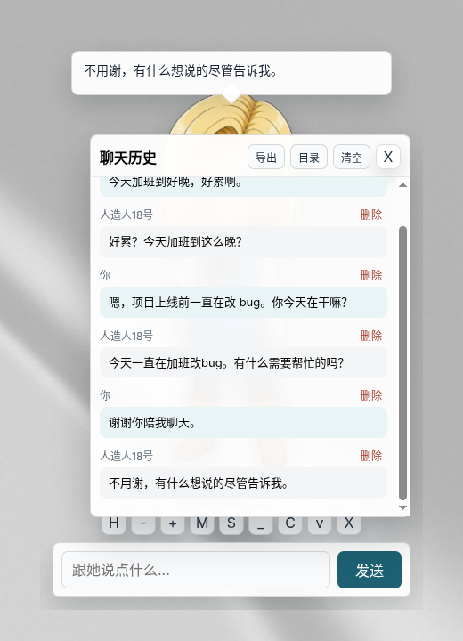](docs/screenshots/02-history.png)

### 功能说明

历史面板可以逐条删除、清空、导出（Markdown / JSON），或直接打开聊天记录目录。聊天记录按「交互模式 + 角色卡 + 模型」分别保存，换角色或换模型不会串台。

### 设计思路

记忆同时存两份：`electron-store` 里保存最近 80 条用于上下文，`chats/` 目录下写快照和按本地日期切分的 JSONL 日志，方便备份或拿去别处用。

### 实现映射

| 层次 | 实现 |
| --- | --- |
| 记忆隔离 | `chatMemoryKey`、`currentMessages`、`setCurrentMessages` |
| 落盘 / 导出 | `writeChatSnapshot`、`exportCurrentChat`、`chatToMarkdown` |
| 文件格式 | [`chats/README.md`](chats/README.md) |

## 3. 设置：云端 API

[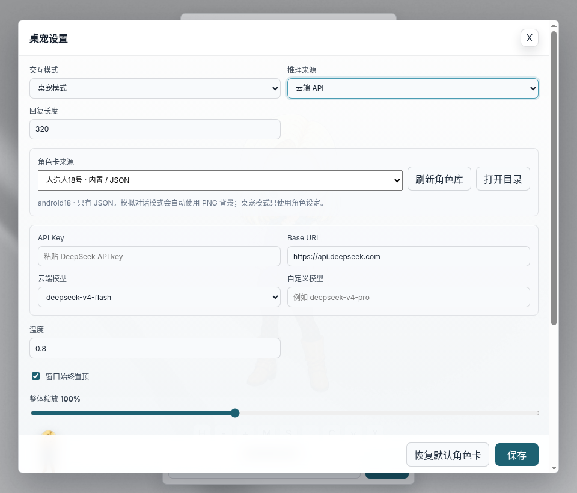](docs/screenshots/03-settings-api.png)

### 功能说明

右键立绘、点工具栏 S 或托盘菜单都能打开设置。云端模式填 API Key、Base URL 和模型名即可，内置 DeepSeek 常用模型，也可以自定义；任何 OpenAI Chat Completions 兼容接口都能用。同一面板里还能调回复长度、温度、整体缩放、窗口置顶和更换立绘图片。

### 设计思路

Key 只保存在本机配置里，输入框留空表示不修改。接口报错时按状态码给出中文提示（401 Key 无效、402 余额不足、429 限流等），并设置 90 秒超时。

### 实现映射

| 层次 | 实现 |
| --- | --- |
| 配置读写 | `getConfig`、`saveConfig`、`toRendererConfig`（去掉明文 Key） |
| 请求 | `askCloudApi`、`cloudErrorHint` |
| 立绘图片 | `selectModelImage`、`getCustomModelImage` |

## 4. 设置：本地 GGUF

[](docs/screenshots/04-settings-local.png)

### 功能说明

切到「本地 GGUF」后，自动扫描 `models/` 和「额外模型目录」里的 `.gguf` 文件；可以导入模型、打开目录、选择 CUDA / Vulkan / CPU，调整显存策略、上下文、批处理、线程数、KV 缓存类型、Flash Attention、mmap 等。推荐模型见 [本地模型](#本地模型)。

### 设计思路

`node-llama-cpp` 在独立的 `utilityProcess` 子进程里加载和推理：推理期间界面不卡；子进程崩溃（显存不足、Electron 内存分配上限等）时桌宠本体不受影响，并提示原因。参数不变时复用已加载的模型，改了参数会自动重新加载。

### 实现映射

| 层次 | 实现 |
| --- | --- |
| 推理子进程 | [`electron/llm-worker.ts`](electron/llm-worker.ts) · `ensureRuntime`、`prompt` |
| 主进程客户端 | [`electron/llm-client.ts`](electron/llm-client.ts) · `LocalLlmClient`；协议 [`shared/llm-protocol.ts`](shared/llm-protocol.ts) |
| 模型扫描 | `scanLocalModels`、`scanDirForModels`、`importLocalModel` |

## 5. 好感度与开发者模式

[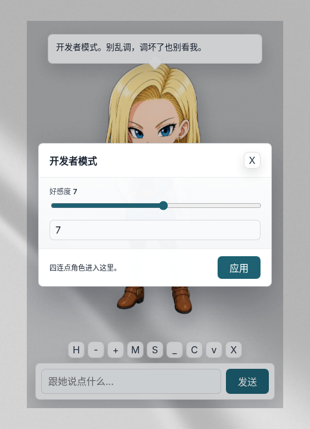](docs/screenshots/05-dev-mode.png)

### 功能说明

好感度范围 -100 ~ 100，分为厌恶 / 疏离 / 普通 / 熟悉 / 亲近五个阶段，会写进系统提示词影响语气。夸她、道谢会加分，骂她会扣分。单击立绘查看当前好感度，**快速连点四下**进入开发者模式，可以直接拖动调整。

### 实现映射

| 层次 | 实现 |
| --- | --- |
| 阶段与提示词 | `affinityStage`、`buildSystemPrompt` |
| 加减分 | [`src/main.ts`](src/main.ts) · `affinityDeltaFrom`、`setAffinity` |

## 6. 角色卡库

[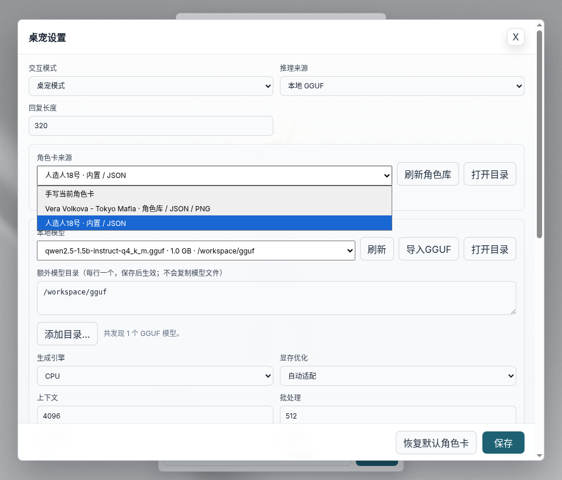](docs/screenshots/06-character-cards.png)

[](docs/screenshots/12-png-card-import.png)

[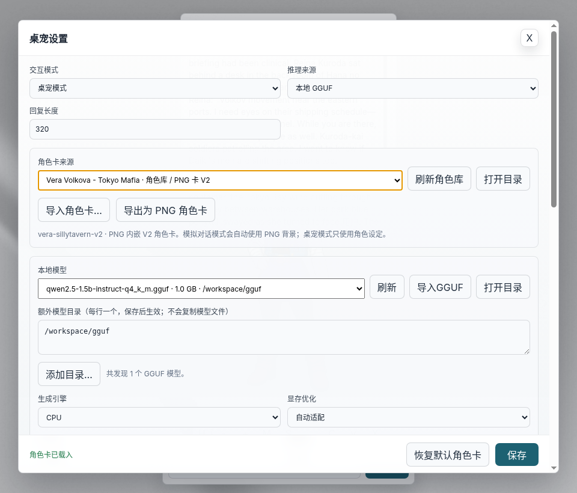](docs/screenshots/13-png-card-loaded.png)

[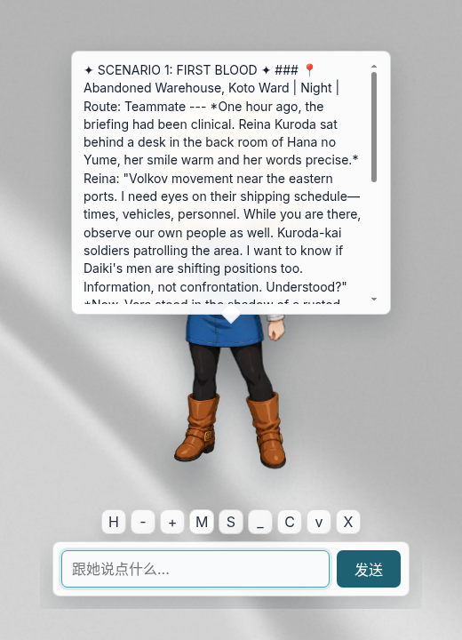](docs/screenshots/07-long-greeting.png)

### 功能说明

内置「人造人18号」角色卡（[`characters/android18.card.json`](characters/android18.card.json)），也可以在设置里手写 JSON，或用「导入角色卡…」把下载的卡复制进 `character-cards/`（也可以手动放进去再刷新）。

- **JSON 卡**：支持 SillyTavern / Chub 常见的 `chara_card_v2` / `chara_card_v3` JSON。
- **PNG 卡**：直接读取 PNG 里 `tEXt` / `iTXt` / `zTXt` 文本块中的 `ccv3`（V3，优先）或 `chara`（V2）角色卡，下拉框标注「PNG 卡 V2 / V3」。截图中第二个 Vera 就是只有一张 PNG 的 SillyTavern V2 卡。
- **导出 PNG 卡**：「导出为 PNG 角色卡」把当前设定写进立绘 PNG，同时带 V2 和 V3 块，可以直接拖进 SillyTavern；原始设定另存在 `extensions.android18_desktop_pet` 中，导回本程序时不丢字段。
- JSON 和同名 PNG 同时存在时设定取自 JSON；PNG 在对话模拟模式中作为背景。导入卡的开场白很长时，气泡会限制高度并可滚动。

### 实现映射

| 层次 | 实现 |
| --- | --- |
| 扫描 / 选择 | `scanCharacterCards`、`selectCharacterCard` |
| PNG 读写 | [`electron/png-card.ts`](electron/png-card.ts) · `readPngCharacterCard`、`writePngCharacterCard` |
| 导入 / 导出 | `importCharacterCards`、`exportCharacterPng` |
| 格式转换 | `normalizeImportedCharacterCard`（清理 HTML、替换 `{{char}}` / `{{user}}`） |
| 说明 | [`character-cards/README.md`](character-cards/README.md) |

## 7. 对话模拟

[](docs/screenshots/08-simulation.png)

### 功能说明

点工具栏 M 进入对话模拟：上方写剧情（或让模型「生成剧情」），下方逐句推进。每一句都能改角色、改内容、删除；也能手动插入用户句 / 角色句、撤回末句，适合写一段完整的剧情对话。

### 设计思路

对话模拟和桌宠模式共用同一套记忆与模型调用，只是系统提示词不同：模拟模式会把用户输入当作剧情中的对白、动作或旁白，允许更长的回复。

### 实现映射

| 层次 | 实现 |
| --- | --- |
| 提示词 | `buildSystemPrompt`（`interactionMode === 'simulation'` 分支） |
| 界面 | [`src/main.ts`](src/main.ts) · `renderSimulation`、`generateStory` 相关事件 |
| 背景 | `getCharacterBackground`、`.sim-modal.has-bg` |

## 8. 插件

[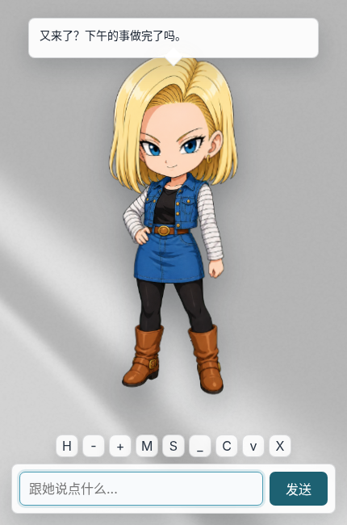](docs/screenshots/09-plugin-greeting.png) [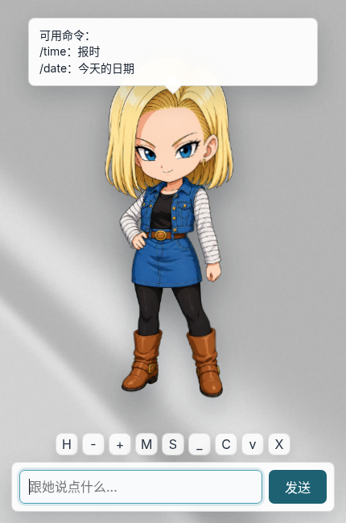](docs/screenshots/10-plugin-command.png)

[](docs/screenshots/11-plugins-settings.png)

### 功能说明

`plugins/<id>/plugin.json` 是一个纯 JSON 的声明式插件，可以提供：按时段问候、定时提醒（每隔 N 分钟 / 每天固定时间）、长时间不聊天时主动搭话、快捷命令（如 `/time`，不发给模型也不写进记忆）、追加系统提示词。设置面板里可以逐个启用 / 停用、重新加载；聊天框输入 `/help` 查看所有命令。桌宠收进托盘时提醒改用系统通知。

附带两个示例：`daily-greetings`（按时段问候 + `/time` `/date`，默认启用）和 `health-reminders`（喝水 / 活动 / 睡觉提醒 + 闲聊，默认关闭）。字段说明见 [plugins/README.md](plugins/README.md)。

### 设计思路

插件**不执行任何代码**，程序只读取并严格校验 JSON（字段类型、时间格式、长度和数量上限、256 KB 大小），所以第三方插件不可能读写文件、联网或拿到 API Key。对桌宠这种“加点台词、加点提醒”的需求，声明式已经够用，也最容易分享。

### 实现映射

| 层次 | 实现 |
| --- | --- |
| 类型 | [`shared/plugin-types.ts`](shared/plugin-types.ts) |
| 加载 / 校验 / 调度 | [`electron/plugins.ts`](electron/plugins.ts) · `parseManifest`、`loadPlugins`、`PluginScheduler` |
| 主进程接入 | `reloadPlugins`、`runPluginCommand`、`emitPluginMessage`、`buildSystemPrompt` |
| 界面 | [`src/main.ts`](src/main.ts) · `renderPlugins`、`onPluginMessage` |
| 测试 | [`tests/plugins.test.ts`](tests/plugins.test.ts) |

> 截图说明：以上截图均为在 Linux（Xvfb + xfce）上 `npm run dev` 实际运行截取。本地对话使用 Qwen2.5-1.5B-Instruct Q4_K_M 纯 CPU 推理，仅用于演示流程，回复质量不代表推荐的 8B 模型。

## 快速开始

环境要求：

- Node.js 20.19+ 或 22.12+（Vite 7 的要求）
- Windows 10/11（主要使用平台）；Linux 也可以开发运行
- 使用本地模型时：NVIDIA 显卡（CUDA）或支持 Vulkan 的显卡效果最好

```bash
git clone https://github.com/Fiesty-Abyss/Android18DesktopPet.git
cd Android18DesktopPet
npm install
cp .env.example .env   # Windows: copy .env.example .env，可选
npm run dev
```

启动后右键立绘打开设置，填 API Key 或切到本地 GGUF 即可开始聊天。

常用脚本：

| 命令 | 作用 |
| --- | --- |
| `npm run dev` | 开发模式（热更新） |
| `npm run typecheck` | TypeScript 类型检查 |
| `npm test` | 单元测试（vitest：PNG 角色卡、插件） |
| `npm run build` | 类型检查 + 构建到 `out/` |
| `npm run dist` | 构建 Windows 绿色版（需在 Windows 上执行） |
| `npm run dist:builder` | 用 electron-builder 打包（Windows：NSIS + portable；Linux：AppImage） |
| `npm run dist:lite` | 同上，但不带 CUDA 二进制（CPU + Vulkan，体积小约 500 MB） |

## 本地模型

作者实测使用、推荐的两个模型（均为 Q4_K_M，约 4.9 GB）：

| 模型文件 | 下载 |
| --- | --- |
| `L3-8B-Stheno-v3.2-Q4_K_M.gguf` | [bartowski/L3-8B-Stheno-v3.2-GGUF](https://huggingface.co/bartowski/L3-8B-Stheno-v3.2-GGUF) |
| `dolphin-2.9.4-llama3.1-8b-Q4_K_M.gguf` | [dphn/dolphin-2.9.4-llama3.1-8b-gguf](https://huggingface.co/dphn/dolphin-2.9.4-llama3.1-8b-gguf) |

1. 下载 `.gguf` 文件，放进项目的 `models/`，或者放在任意文件夹后在设置里把该文件夹加入「额外模型目录」。
2. 设置 → 推理来源选「本地 GGUF」→ 选择模型 → 生成引擎选 CUDA（N 卡）或 Vulkan → 保存。
3. 发第一句话时加载模型，稍等即可。

推荐参数、许可证和纯 CPU 运行的注意事项见 [models/README.md](models/README.md)。模型文件已被 `.gitignore` 忽略，不要提交到仓库。

## 打包

```bash
npm run dist          # Windows 绿色版 → dist/Android18DesktopPet/Android18DesktopPet.exe
npm run dist:builder  # electron-builder → dist/（完整版，含 CUDA）
npm run dist:lite     # electron-builder → dist/（lite 版，CPU + Vulkan）
```

打包后 `models/`、`character-cards/`、`plugins/`、`chats/` 等目录位于 exe 同级，方便直接放模型、角色卡和插件。打包配置见 [`electron-builder.config.cjs`](electron-builder.config.cjs)：只带目标平台的 `node-llama-cpp` 预编译二进制，不带 llama.cpp 源码包；本机的模型权重和聊天记录不会被打进去。

| 版本 | Linux x64 解包体积 | 说明 |
| --- | --- | --- |
| 完整版 | 约 937 MB | CPU + Vulkan + CUDA，N 卡推荐 |
| lite 版 | 约 399 MB | CPU + Vulkan，A 卡 / I 卡 / 只用云端 API 时足够 |

**下载**：在 GitHub Releases 发布版本时，[Release 工作流](.github/workflows/release.yml) 会在 Windows 上自动构建安装包与绿色版（完整版和 lite 版）并附到 Release。

## 目录结构

```text
electron/
  main.ts           主进程：窗口、托盘、配置、云端请求、角色卡、聊天记录
  llm-worker.ts     本地 GGUF 推理子进程（utilityProcess）
  llm-client.ts     主进程侧的推理子进程客户端
  preload.ts        contextBridge，暴露 window.pet
  png-card.ts       SillyTavern PNG 角色卡读写
  plugins.ts        插件加载、校验与调度
shared/             三端共用的类型与消息协议
src/                渲染进程界面（原生 TypeScript + CSS）
assets/             立绘、应用图标、托盘图标
characters/         内置默认角色卡
character-cards/    用户角色卡库（json / png）
models/             本地 GGUF 模型（不入库）
chats/              运行时聊天记录（不入库）
plugins/            声明式插件（附两个示例）
cache/              预留目录
tests/              vitest 单元测试
docs/screenshots/   README 截图
scripts/            Windows 绿色版打包脚本
.github/            CI、Release 工作流与 Issue 模板
```

## 配置

复制 `.env.example` 为 `.env`（可选，也可以全部在设置面板里填）：

```env
DEEPSEEK_API_KEY=your_api_key_here
DEEPSEEK_BASE_URL=https://api.deepseek.com
DEEPSEEK_MODEL=deepseek-v4-flash
```

其余设置保存在系统用户目录下的 `electron-store` 配置文件中（Windows：`%APPDATA%\android-18-desktop-pet\config.json`）。**不要**把真实 `.env` 或 API Key 提交到 Git。

## 技术栈

| 部分 | 技术 |
| --- | --- |
| 桌面壳 | Electron 44 + electron-vite 4 |
| 语言 | TypeScript（主进程 / preload / 渲染进程共用类型） |
| 界面 | 原生 DOM + CSS，无前端框架 |
| 本地推理 | node-llama-cpp 3（llama.cpp），运行在 utilityProcess |
| 云端推理 | OpenAI Chat Completions 兼容接口（默认 DeepSeek） |
| 配置持久化 | electron-store |
| 打包 | electron-builder / 自带 Windows 绿色版脚本 |
| 测试 / CI | vitest · GitHub Actions（Ubuntu + Windows） |

## 已知限制

- 纯 CPU 运行较大的模型时，可能触发 Electron 单次 2 GiB 内存分配上限导致推理子进程退出（桌宠本体不受影响），建议开启 GPU，详见 [models/README.md](models/README.md#关于纯-cpu-运行)。
- 插件是声明式的，只能说话、响应命令和追加提示词，不能调用外部服务（例如天气）；这是有意为之的安全取舍。
- 角色卡的世界书（`character_book`）、多开场白（`alternate_greetings`）暂不使用。
- 剩余的 `npm audit` 告警来自打包工具链和 node-llama-cpp 从源码编译时才用到的 `simple-git`，运行时不涉及；npm 给出的“修复”是降级大版本，暂未处理。
- Linux 下透明窗口和托盘图标依赖桌面环境的合成器 / 托盘支持。

## FAQ

<details>
<summary><b>不想花钱 / 没有 API Key 能用吗？</b></summary>

可以。设置里把推理来源切到「本地 GGUF」，下载一个模型放进 `models/`（推荐的两个 8B 模型见 [本地模型](#本地模型)），全部在本机运行，不需要联网。
</details>

<details>
<summary><b>本地模型需要什么配置？</b></summary>

8B Q4_K_M 模型约 4.9 GB，建议 8 GB 显存的 NVIDIA 显卡（CUDA）；6 GB 左右显存可用 Vulkan 并开启 KV 缓存量化；没有独显也能用 CPU 跑小模型，但会比较慢。具体参数见 [models/README.md](models/README.md)。
</details>

<details>
<summary><b>完整版和 lite 版有什么区别？</b></summary>

完整版带 CUDA 二进制（N 卡推荐）；lite 版只有 CPU + Vulkan，体积小约 500 MB，A 卡 / I 卡或只用云端 API 时足够。
</details>

<details>
<summary><b>可以换成别的角色吗？</b></summary>

可以。设置 → 角色卡库 →「导入角色卡…」，选择 SillyTavern / Chub 下载的 JSON 或 PNG 卡即可；也可以直接手写 JSON 设定。立绘目前固定为人造人18号。
</details>

<details>
<summary><b>聊天记录存在哪？会上传吗？</b></summary>

保存在程序目录的 `chats/`（JSONL 日志 + 快照）和系统用户目录的配置文件里。使用云端 API 时，对话内容会发送给你配置的服务商；使用本地模型时不会离开本机。
</details>

<details>
<summary><b>插件安全吗？能写一个查天气的插件吗？</b></summary>

插件只是 JSON，程序不会执行其中的任何代码，所以第三方插件无法读写文件、联网或拿到 API Key。代价是插件不能调用外部服务，查天气这类需求暂不支持。写法见 [plugins/README.md](plugins/README.md)。
</details>

<details>
<summary><b>用本地模型时推理进程退出了？</b></summary>

多半是纯 CPU 跑较大模型时触发了 Electron 单次 2 GiB 内存分配上限。桌宠本体不受影响，开启 GPU（CUDA / Vulkan）把大部分层放到显存即可，详见 [已知限制](#已知限制)。
</details>

<details>
<summary><b>支持 macOS 吗？</b></summary>

目前只在 Windows（主要平台）和 Linux 上测试过，没有提供 macOS 安装包。
</details>

## 路线图

- [x] 透明桌宠、托盘、好感度、对话模拟
- [x] 云端 API 与本地 GGUF 双推理来源，本地推理独立子进程
- [x] 角色卡库：JSON / SillyTavern PNG 卡导入导出
- [x] 声明式插件：问候、提醒、闲置搭话、快捷命令
- [x] CI、Windows 安装包自动发布
- [ ] 角色卡世界书（`character_book`）与多开场白（`alternate_greetings`）
- [ ] 自定义立绘 / 跟随角色卡切换立绘
- [ ] 语音朗读（TTS）
- [ ] 流式输出，回复逐字显示
- [ ] macOS 安装包

## 说明

个人兴趣项目，源码以 [MIT 许可证](LICENSE) 发布。立绘与示例角色卡为 AI 生成素材；第三方模型权重、角色卡等不在本项目许可证范围内，请遵守各自的许可证。
